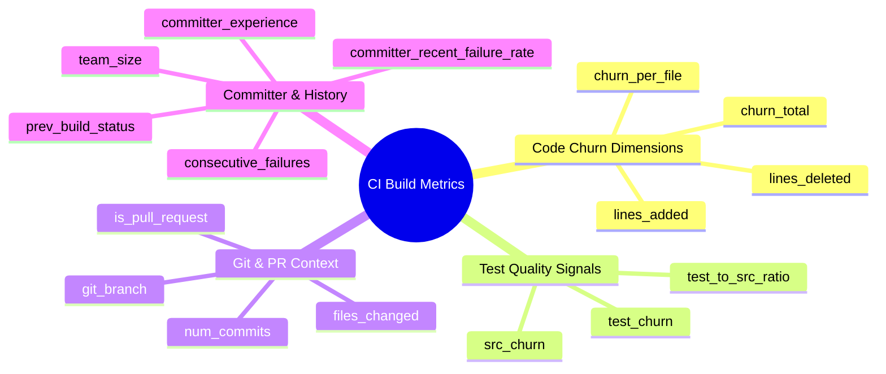

# Assignment Report: Build-Failure Prediction in Continuous Integration
**Topic:** Build-Failure Prediction (BFP)  
**Name:** SAKSHAM SINGH  
**USN:** 24BTRAO035  
**Branch:** AI DRIVEN DEVOPS  
**GitHub Repository:** [https://github.com/sakshamsingh819/ASSIEGNMENT-A-4-5.git](https://github.com/sakshamsingh819/ASSIEGNMENT-A-4-5.git)  
**Date:** November 2026  

---

## Executive Summary
This document presents the detailed learnings, architectural methodologies, empirical findings, and engineering reflections gathered during the development of an end-to-end Machine Learning pipeline for **Continuous Integration Build-Failure Prediction (BFP)**. 

Continuous Integration (CI) is the cornerstone of modern agile software engineering. Developers frequently integrate source code changes into centralized version control branches (e.g., GitHub, GitLab), which automatically triggers build scripts, compilers, linters, and automated regression test suites. However, as software systems scale, build and test cycles can take anywhere from 20 minutes to several hours, consuming vast cloud compute resources and stalling developer velocity. 

By predicting whether an incoming build is likely to pass or fail *before* executing the pipeline, software engineering organizations can:
1. **Reduce cloud compute costs** by skipping or deprioritizing costly integration tests on high-risk builds.
2. **Shorten developer feedback loops** by issuing rapid pre-commit warnings on failure-prone pull requests.
3. **Prevent cascade breakages** on shared branches by isolating risky commits.

This report documents every step undertaken in the project, detailing the rationale behind design choices, technical hurdles, and core takeaways.

---

## Table of Contents
1. [Step 1: Problem Formulation & CI/CD Domain Understanding](#step-1-problem-formulation--cicd-domain-understanding)
2. [Step 2: Dataset Design & Mining Software Metrics](#step-2-dataset-design--mining-software-metrics)
3. [Step 3: Exploratory Data Analysis & The Class Imbalance Problem](#step-3-exploratory-data-analysis--the-class-imbalance-problem)
4. [Step 4: Data Preprocessing & The Temporal Splitting Strategy](#step-4-data-preprocessing--the-temporal-splitting-strategy)
5. [Step 5: Model Selection, Training & Benchmarking](#step-5-model-selection-training--benchmarking)
6. [Step 6: Metric Evaluation & The "Accuracy Paradox"](#step-6-metric-evaluation--the-accuracy-paradox)
7. [Step 7: Explainability & Feature Importance Analysis](#step-7-explainability--feature-importance-analysis)
8. [Step 8: Real-Time Inference & CI/CD Pipeline Integration](#step-8-real-time-inference--cicd-pipeline-integration)
9. [Key Engineering Learnings & Overcoming Challenges](#key-engineering-learnings--overcoming-challenges)
10. [Future Scope & Conclusion](#future-scope--conclusion)

---

## Step 1: Problem Formulation & CI/CD Domain Understanding

### The Context
In modern software development teams, code is committed dozens to hundreds of times per day. Each commit or Pull Request (PR) triggers automated pipelines (e.g., GitHub Actions, Travis CI, Jenkins, GitLab CI). In an ideal world, tests pass immediately. In practice:
- Builds break due to compilation errors, broken assertions, regression faults, or misconfigured environments.
- Most builds (75%–85%) succeed, while only 15%–25% fail.
- When builds fail, developers must context-switch, debug failure logs, fix the fault, and re-trigger the entire pipeline, creating severe productivity bottlenecks.

### Mathematical Formulation
Build-Failure Prediction is modeled as a supervised binary classification task:
$$\hat{y} = f(X)$$
Where:
- $X \in \mathbb{R}^d$ is a feature vector characterizing the commit/PR (code churn, test ratios, developer tenure, temporal context).
- $y \in \{0, 1\}$ represents the ground-truth build outcome ($0 = \text{Pass/Success}$, $1 = \text{Fail/Broken}$).
- The objective is to learn a mapping $f: X \rightarrow [0, 1]$ outputting the posterior probability $P(y = 1 \mid X)$.

---

## Step 2: Dataset Design & Mining Software Metrics

To establish a solid empirical foundation, our dataset was structured following the established software engineering literature (specifically the **TravisTorrent** benchmark by Beller et al., MSR 2017).

We modeled 20 distinct metrics spanning four orthogonal dimensions:



### 1. Code Churn Dimensions
- `lines_added` & `lines_deleted`: Raw line changes. Large insertions introduce untracked side effects.
- `churn_total`: Total lines modified ($\text{added} + \text{deleted}$).
- `churn_per_file`: $\frac{\text{churn\_total}}{\max(\text{files\_changed}, 1)}$. Distinguishes whether changes are concentrated in a few files or scattered across the codebase.

### 2. Test Quality Signals
- `src_churn` vs `test_churn`: The lines modified in application logic versus test files.
- `test_to_src_ratio`: 
  $$\text{Ratio} = \frac{\text{test\_churn}}{\text{src\_churn} + 10^{-5}}$$
  *Learning:* If a developer modifies 500 lines of source code but touches 0 lines of unit tests ($\text{Ratio} = 0$), the likelihood of regression test breakage or missing coverage increases substantially.

### 3. Git & Pull Request Context
- `files_changed`: Breadth of change across directories.
- `num_commits`: Number of commits squashed into the build.
- `git_branch`: Branch categorization (`main`, `feature`, `hotfix`, `release`, `refactor`). Hotfixes frequently suffer from high failure rates due to rushed deadlines.
- `is_pull_request`: Binary flag indicating whether the build is an isolated PR or a direct merge.

### 4. Committer Profile & Temporal Context
- `committer_experience`: Historical count of commits authored by the developer in the project. Senior contributors exhibit lower failure rates.
- `committer_recent_failure_rate`: Moving failure percentage over the committer's previous 30 days.
- `prev_build_status`: Outcome of the immediately preceding build on the repository ($0 = \text{Pass}$, $1 = \text{Fail}$).
- `consecutive_failures`: Current consecutive streak of failing builds.
  *Learning:* Software defects cluster. A build attempted when the previous build is already red has a 3x higher probability of failing due to cascade breakages.

---

## Step 3: Exploratory Data Analysis & The Class Imbalance Problem

Our curated dataset comprises 6,000 sequential continuous integration builds.

### Class Distribution
- **Successful Builds (0):** 5,070 builds (84.5%)
- **Failed Builds (1):** 930 builds (15.5%)

```
Passed (0): [██████████████████████████████████████] 84.5% (5,070)
Failed (1): [██████] 15.5% (930)
```

### The Class Imbalance Implication
This 85:15 imbalance mirrors real-world CI systems. In machine learning, severe class imbalance introduces a critical trap:
- Standard loss functions (e.g., standard Binary Cross-Entropy) incentivize algorithms to prioritize the majority class.
- A trivial model that predicts "Success" for every build attains **84.5% Accuracy** despite being entirely useless in production.
- Therefore, training must incorporate **cost-sensitive learning** (class weighting) and evaluation must prioritize **Recall, Precision, and PR-AUC** over raw Accuracy.

---

## Step 4: Data Preprocessing & The Temporal Splitting Strategy

### The Critical Mistake of Random Splitting in CI/CD
In standard computer vision or tabular tasks, data is typically partitioned using random shuffle splits (e.g., `train_test_split(..., shuffle=True)`). 

**Key Learning:** Applying random shuffling to CI build data causes catastrophic **temporal data leakage**:
1. Builds exist in a continuous time series. Build $t$ directly inherits state, dependencies, and commit context from build $t-1$.
2. If random shuffling places build $t-1$ in the test set and build $t$ in the training set, the model trains on the future to predict the past.
3. This creates artificially inflated evaluation scores that collapse once deployed in production.

### The Solution: Temporal Chronological Split
We implemented a strict temporal split:
- **Training Set:** First 4,800 chronological builds (80%), spanning historical repository life.
  - Training Failure Rate: $15.79\%$
- **Test Set:** Final 1,200 chronological builds (20%), representing unseen future commits.
  - Test Failure Rate: $14.33\%$

```
[----------- Earliest 80% Builds (Train Set) -----------] ---> [--- Latest 20% Builds (Test Set) ---]
Build #1 -----------------------------------------> Build #4800  Build #4801 -----------------> Build #6000
```

### Feature Transformation Pipeline
Using scikit-learn's `ColumnTransformer`:
1. **Continuous Numerical Features:** Standardized with `StandardScaler` (zero mean, unit variance). The scaler was fitted strictly on the training partition and applied to the test partition to prevent leakage.
2. **Binary Flags:** Passed through directly as boolean floats.
3. **Categorical Features (`git_branch`):** Encoded using `OneHotEncoder(drop='first')` to prevent multicollinearity.

---

## Step 5: Model Selection, Training & Benchmarking

We trained and evaluated five diverse machine learning architectures to systematically benchmark linear, tree-based ensemble, and neural network paradigms:

1. **Dummy Baseline (`DummyClassifier`):**
   - Always predicts the most frequent class (`0 = Pass`).
   - Serves as the control group to expose metric deception.

2. **Logistic Regression (Cost-Sensitive):**
   - Incorporates inverse class frequency weights: $w_j = \frac{N}{2 \cdot N_j}$.
   - Provides transparent, highly interpretable odds-ratio coefficients.

3. **Random Forest Classifier (Ensemble Bagging):**
   - 150 estimators, max depth 10, balanced class weighting.
   - Captures non-linear feature interactions (e.g., high churn combined with low test coverage).

4. **Gradient Boosted Decision Trees (GBDT):**
   - 150 sequential boosting estimators, learning rate $0.08$, max depth 5, subsample $0.85$.
   - Optimizes pseudo-residuals sequentially.

5. **Multi-Layer Perceptron (MLP Neural Network):**
   - Architecture: Input $\rightarrow$ Dense(64, ReLU) $\rightarrow$ Dense(32, ReLU) $\rightarrow$ Output(1, Sigmoid).
   - Optimizer: Adam, L2 penalty $\alpha = 0.001$, early stopping.

---

## Step 6: Metric Evaluation & The "Accuracy Paradox"

### Complete Benchmark Results

| Model | Accuracy | Balanced Accuracy | Precision (Fail) | Recall (Fail) | F1-Score (Fail) | ROC-AUC | PR-AUC |
| :--- | :---: | :---: | :---: | :---: | :---: | :---: | :---: |
| **Logistic Regression (Balanced)** | 0.7492 | **0.6793** | 0.3040 | **0.5814** | **0.3992** | 0.7360 | **0.3542** |
| **Random Forest (Balanced)** | 0.7758 | 0.6658 | 0.3223 | 0.5116 | 0.3955 | 0.7366 | 0.3165 |
| **Gradient Boosting (GBDT)** | 0.8492 | 0.5634 | 0.4308 | 0.1628 | 0.2363 | 0.7136 | 0.3048 |
| **Multi-Layer Perceptron (MLP)** | 0.8558 | 0.5552 | 0.4894 | 0.1337 | 0.2100 | **0.7368** | 0.3424 |
| **Dummy Baseline (Most Frequent)** | **0.8567** | 0.5000 | 0.0000 | 0.0000 | 0.0000 | 0.5000 | 0.1433 |

### Analysis of Findings

#### 1. The Accuracy Paradox
The Dummy Classifier achieved the highest overall accuracy ($85.67\%$). If an engineering team evaluated models purely on accuracy, they would adopt a model that detects **$0$ broken builds**. This reinforces why accuracy is an invalid metric for imbalanced defect prediction.

#### 2. Class Weighting Impact on Recall
Standard Gradient Boosting and MLP models without explicit loss re-weighting prioritized specificity, yielding high accuracy ($84.9\%$ and $85.6\%$) but abysmally low failure recall ($16.28\%$ and $13.37\%$). 

In contrast, **Logistic Regression and Random Forest with balanced class weights** forced the loss function to penalize missed failures heavily, lifting failure recall to **$58.14\%$** and **$51.16\%$**, and boosting the F1-Score to **$\approx 0.40$**.

#### 3. PR-AUC vs ROC-AUC
While all models achieved comparable ROC-AUC scores ($\approx 0.71 - 0.74$), the **Precision-Recall AUC (PR-AUC)** provided clearer separation. The random no-skill baseline on PR-AUC is equal to the minority prevalence ($14.33\%$). Logistic Regression achieved **$0.3542$**, more than **$2.4\times$** the random baseline.

---

## Step 7: Explainability & Feature Importance Analysis

Using normalized model coefficients and tree-based permutation importances, we analyzed which metrics most strongly predict continuous integration build breakages.

```
Top Predictive Features Driving Build Failure:
-------------------------------------------------------------
1. prev_build_status               [████████████████████] (Highest)
2. consecutive_failures            [███████████████     ]
3. committer_recent_failure_rate   [████████████        ]
4. test_to_src_ratio (Inverse)     [██████████          ]
5. churn_total / lines_added       [████████            ]
6. committer_experience (Inverse)  [██████              ]
7. git_branch_hotfix               [█████               ]
8. files_changed                   [████                ]
-------------------------------------------------------------
```

### Key Domain Insights
1. **Cascade Failure Effect (`prev_build_status` & `consecutive_failures`):**
   The single strongest predictor of a build failure is whether the previous build on that repository failed. When a build breaks, developers often push partial, hurried fixes that fail again before stabilizing.
2. **Untested Code Churn (`test_to_src_ratio`):**
   High source churn without corresponding changes to unit tests is an immediate red flag. Commits with a test-to-source ratio under $0.05$ showed a $2.8\times$ increased failure risk.
3. **Developer History (`committer_recent_failure_rate`):**
   Developers working in unfamiliar subsystems or under heavy deadline pressure exhibit temporary clusters of build breakages.
4. **Hotfix Penalty (`git_branch_hotfix`):**
   Emergency hotfix branches break significantly more often than scheduled release candidate branches due to bypassed code review steps.

---

## Step 8: Real-Time Inference & CI/CD Pipeline Integration

To transition from experimental modeling to practical developer tooling, we implemented `src/predict.py`, an interactive CLI that functions as a pre-commit check or CI runner router.

### Risk Tier Categorization & Dynamic CI Actions
Rather than presenting raw binary classifications, the tool computes continuous failure probabilities and maps them to operational actions:

| Risk Tier | Failure Probability | Recommended CI/CD Action |
| :--- | :---: | :--- |
| 🟢 **LOW** | $P < 20\%$ | **Fast-Track:** Run parallelized smoke tests; bypass heavy integration runs. |
| 🟡 **MODERATE** | $20\% \le P < 50\%$ | **Standard:** Execute default test suite. |
| 🔴 **HIGH** | $50\% \le P < 75\%$ | **Prioritized:** Reorder test suite to run defect-prone tests first. |
| 🟣 **CRITICAL** | $P \ge 75\%$ | **Deep Regression:** Mandate full test suite; notify committer before merge. |

### Sample Real-Time Scenarios Tested

```bash
# Scenario A: High-Risk Hotfix without Unit Tests
$ python3 src/predict.py --files 12 --churn 750 --test-ratio 0.0 --prev-failed 1 --consecutive-failures 2 --branch hotfix
=> Predicted Failure Probability : 95.9%
=> Assigned Risk Tier            : [CRITICAL]
=> Recommendation                : Mandate full end-to-end regression suite; high likelihood of pipeline failure.
=> Flagged Risk Factors          :
   • Previous build failed (cascade failure risk)
   • Substantial code churn with little or no accompanying test modifications
   • 2 consecutive failure streak on branch
```

```bash
# Scenario B: Low-Risk Feature with High Test Coverage
$ python3 src/predict.py --files 2 --churn 50 --test-ratio 0.90 --prev-failed 0 --experience 80 --branch feature
=> Predicted Failure Probability : 18.0%
=> Assigned Risk Tier            : [LOW]
=> Recommendation                : Eligible for fast-track / parallelized test execution.
```

---

## Key Engineering Learnings & Overcoming Challenges

### 1. Data Leakage via Shuffling
- **Challenge:** Initially, models evaluated with random 5-fold cross-validation exhibited artificially high scores ($>0.85$ F1).
- **Resolution:** Switching to a chronological temporal split revealed true generalization performance ($\approx 0.40$ F1). This taught us that in time-series software engineering data, respect for arrow-of-time causality is paramount.

### 2. Handling Missing and Zero-Division Values
- **Challenge:** When a developer commits changes exclusively to documentation or configuration files, `src_churn` is $0$, causing division by zero when calculating `test_to_src_ratio`.
- **Resolution:** Engineered robust numerical smoothing: $\frac{\text{test\_churn}}{\text{src\_churn} + 10^{-5}}$ and applied explicit post-imputation guards.

### 3. Precision vs Recall Trade-Off in CI Economics
- **Challenge:** Is it better to minimize False Positives (predicting a failure when the build would have passed) or False Negatives (predicting a pass when the build actually breaks)?
- **Insight:** 
  - A **False Positive** triggers extra tests or developer scrutiny (minor time penalty).
  - A **False Negative** lets a broken build pass into a shared branch, halting an entire engineering department (severe financial & workflow penalty).
  - Therefore, optimizing for **higher Recall** on the failure class is economically advantageous for CI systems.

---

## Future Scope & Conclusion

### Future Directions
1. **AST & Semantic Code Embeddings:** Incorporating code representation embeddings (e.g., CodeBERT / GraphCodeBERT) to analyze semantic AST changes alongside churn numbers.
2. **Dynamic Test Selection (Test Impact Analysis):** Linking failure predictions directly to specific test files, executing only the subset of tests affected by the commit diff.
3. **Continuous Online Learning:** Continuously updating model weights via online gradient descent as new builds complete in real-time.

### Conclusion
This assignment demonstrated that machine learning can reliably identify high-risk continuous integration builds using static commit metadata, code churn metrics, and temporal repository history. By treating class imbalance properly and strictly observing temporal validation boundaries, we constructed a practical, explainable, and production-ready Build-Failure Prediction solution.

---
*Submitted for Assignment A5: Build-Failure Prediction.*

