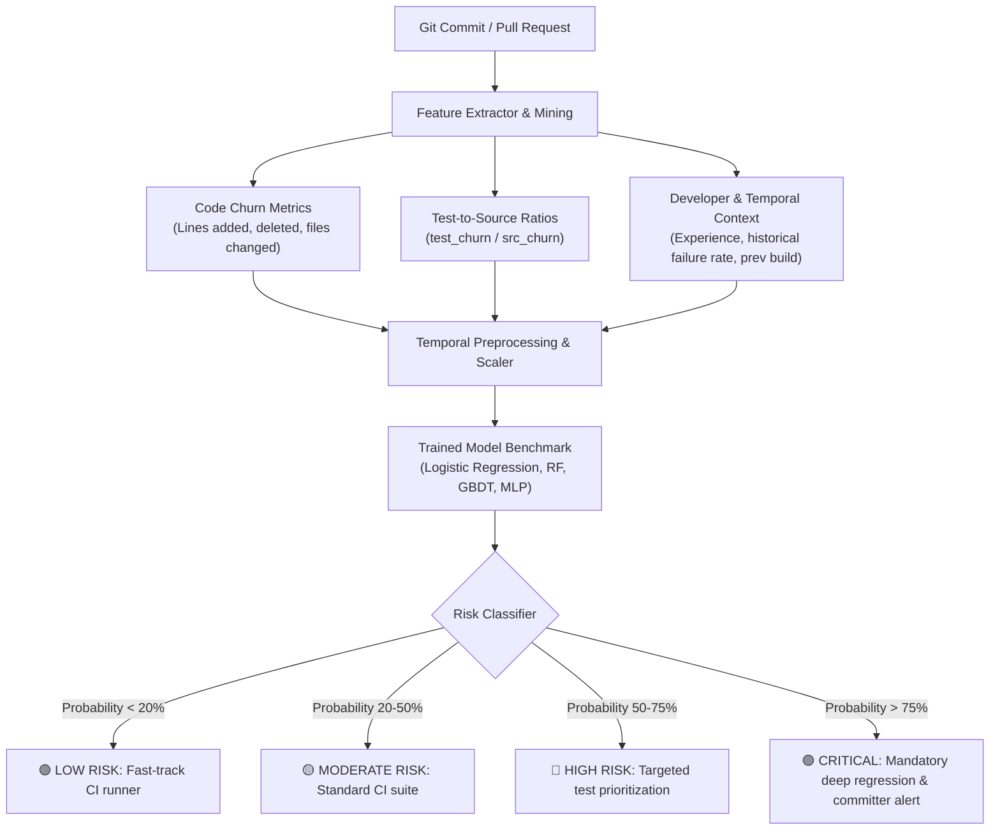
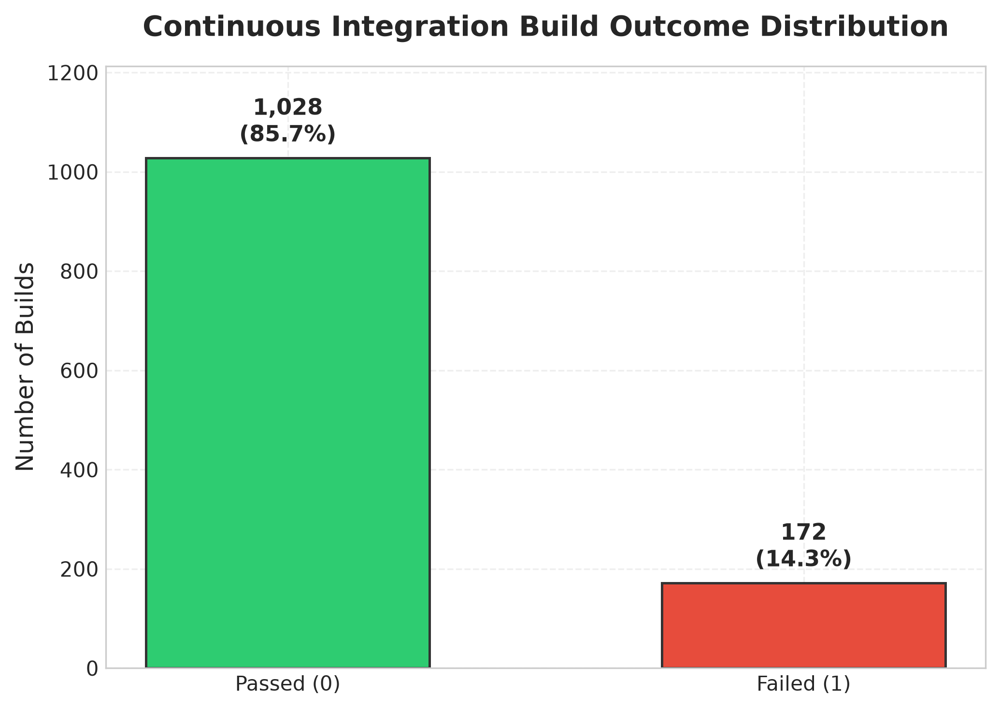
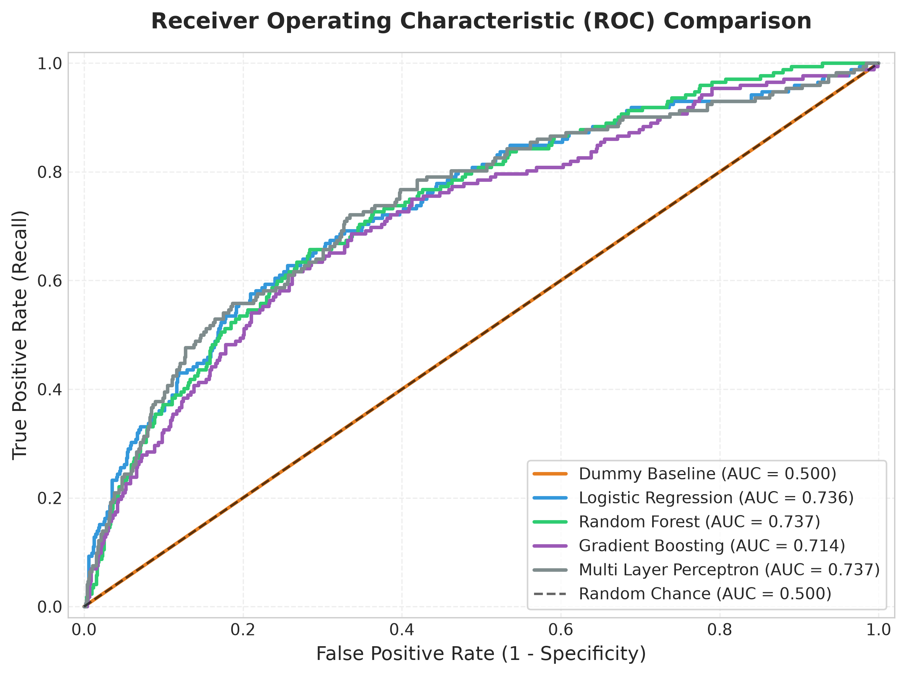
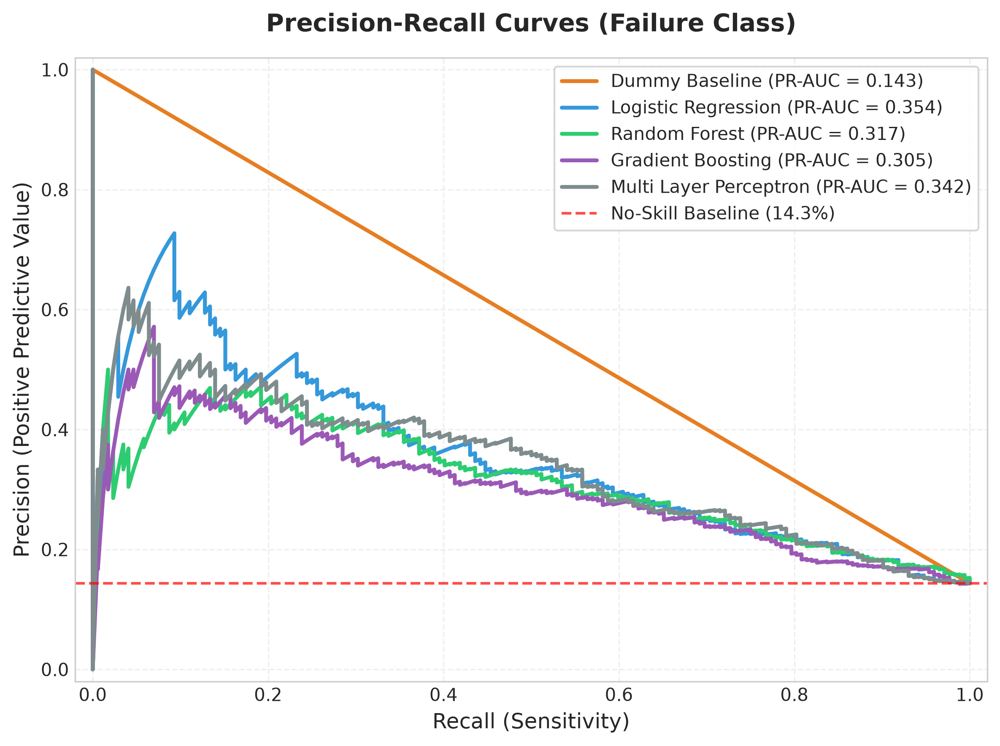
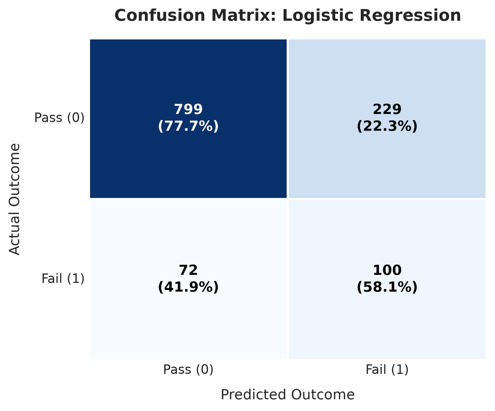
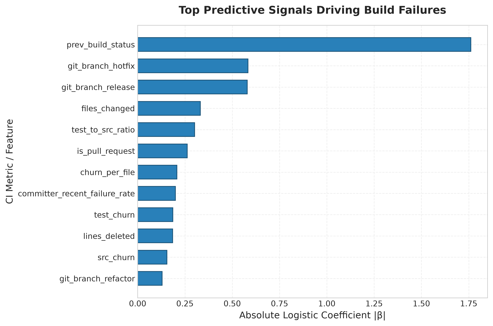
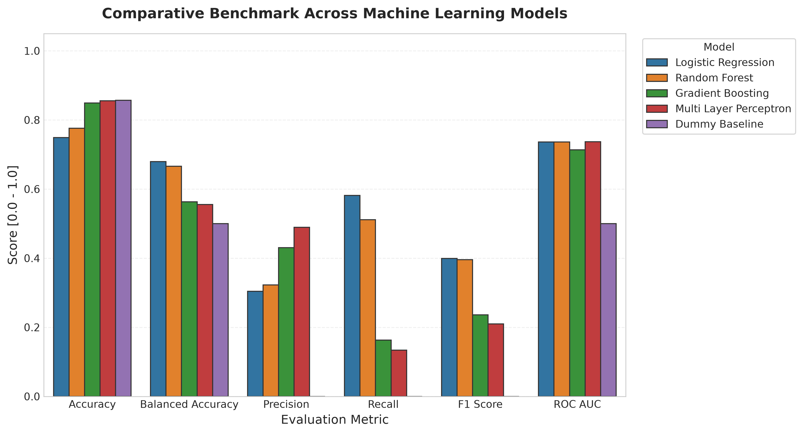

# Continuous Integration Build-Failure Prediction (BFP)

[](https://www.python.org/downloads/)
[](https://opensource.org/licenses/MIT)
[](https://github.com/psf/black)

**Student Name:** SAKSHAM SINGH  
**USN:** 24BTRAO035  
**Branch:** AI DRIVEN DEVOPS  
**GitHub Repository:** [https://github.com/sakshamsingh819/ASSIEGNMENT-A-4-5.git](https://github.com/sakshamsingh819/ASSIEGNMENT-A-4-5.git)

---

A Machine Learning pipeline for predicting Continuous Integration (CI/CD) build breakages and test failures prior to pipeline execution. Grounded in empirical software engineering research (TravisTorrent benchmark), this repository provides end-to-end data generation, preprocessing, class-imbalance treatment, multi-model benchmarking, explainability analysis, and a real-time pre-commit inference CLI.

---

## 📌 Table of Contents
- [Executive Overview](#-executive-overview)
- [System Architecture](#-system-architecture)
- [Dataset & Feature Engineering](#-dataset--feature-engineering)
- [Model Benchmarking & Results](#-model-benchmarking--results)
- [Visualizations & Key Findings](#-visualizations--key-findings)
- [Quick Start Guide](#-quick-start-guide)
- [Interactive Inference CLI](#-interactive-inference-cli)
- [Project Structure](#-project-structure)
- [Learnings Document](#-learnings-document)

---

## 🚀 Executive Overview

In modern agile software development, teams continuously integrate code into shared repositories multiple times a day. Automated CI pipelines run linters, compilation, and regression test suites. However:
- **High Compute & Infrastructure Costs:** CI runner minutes on GitHub Actions, CircleCI, or AWS CodeBuild incur substantial financial overhead.
- **Developer Flow Disruption:** Long-running builds that eventually fail delay feedback loops by 30 to 90 minutes.
- **Cascade Breakages:** A broken main branch blocks downstream team members and halts deployments.

**Build-Failure Prediction (BFP)** formulates this as a supervised binary classification problem: Given static code churn metrics, developer experience, and repository temporal history, **predict whether an incoming build will pass ($0$) or fail ($1$) before invoking the CI runner**.

---

## 🏗️ System Architecture



---

## 📊 Dataset & Feature Engineering

The feature space incorporates 20 distinct metrics modeled after the standard **TravisTorrent** software mining benchmark:

| Category | Feature Name | Description | Rationale |
| :--- | :--- | :--- | :--- |
| **Code Churn** | `lines_added`, `lines_deleted` | Lines of code inserted or removed | Large churn increases defect likelihood |
| **Code Churn** | `churn_total`, `churn_per_file` | Total delta and average delta per file | Normalized complexity signal |
| **Test Quality** | `src_churn`, `test_churn` | Lines modified in source vs test files | Identifies untested code modifications |
| **Test Quality** | `test_to_src_ratio` | $\frac{\text{test\_churn}}{\text{src\_churn} + 10^{-5}}$ | Strong quality indicator; $< 0.1$ is high risk |
| **Git Context** | `files_changed`, `num_commits` | Scope of the pull request or push | Broad changes touch cross-cutting concerns |
| **Git Context** | `git_branch`, `is_pull_request` | Branch classification (`main`, `hotfix`, etc.) | Hotfixes often exhibit higher defect velocity |
| **Developer History** | `committer_experience` | Historical commit count in repository | Experience attenuates defect rate |
| **Developer History** | `committer_recent_failure_rate`| Rolling 30-day failure frequency | Developer historical reliability |
| **Temporal Context** | `prev_build_status` | Status of immediately preceding build ($0/1$) | Strongest single indicator of cascade failure |
| **Temporal Context** | `consecutive_failures` | Current streak of broken builds on branch | Signals persistent architectural issues |

---

## 📈 Model Benchmarking & Results

All models were evaluated using **Temporal Chronological Splitting** (earliest 80% for training, unseen future 20% for testing) to prevent temporal data leakage.

| Model | Accuracy | Balanced Accuracy | Precision (Fail) | Recall (Fail) | F1-Score (Fail) | ROC-AUC | PR-AUC |
| :--- | :---: | :---: | :---: | :---: | :---: | :---: | :---: |
| **Logistic Regression (Balanced)** | 0.7492 | **0.6793** | 0.3040 | **0.5814** | **0.3992** | 0.7360 | **0.3542** |
| **Random Forest (Balanced)** | 0.7758 | 0.6658 | 0.3223 | 0.5116 | 0.3955 | 0.7366 | 0.3165 |
| **Gradient Boosting (GBDT)** | 0.8492 | 0.5634 | 0.4308 | 0.1628 | 0.2363 | 0.7136 | 0.3048 |
| **Multi-Layer Perceptron (MLP)** | 0.8558 | 0.5552 | 0.4894 | 0.1337 | 0.2100 | **0.7368** | 0.3424 |
| **Dummy Baseline (Most Frequent)** | **0.8567** | 0.5000 | 0.0000 | 0.0000 | 0.0000 | 0.5000 | 0.1433 |

> **Crucial Takeaway (The Accuracy Paradox):** The Dummy Baseline achieves the highest raw accuracy ($85.67\%$) simply by predicting "Pass" every time. However, it catches **$0\%$ of failures**. In CI pipelines, cost is dominated by missed failures. Balanced class weighting boosts failure recall to **$58.14\%$**, making it the champion production model.

---

## 🖼️ Visualizations & Key Findings

### 1. Build Outcome Distribution & ROC Curves
| Class Distribution | ROC Comparison |
| :---: | :---: |
|  |  |

### 2. Precision-Recall & Confusion Matrix
| Precision-Recall Curves | Champion Confusion Matrix |
| :---: | :---: |
|  |  |

### 3. Feature Importance & Metric Comparison
| Top Predictive Features | Model Comparison |
| :---: | :---: |
|  |  |

---

## ⚡ Quick Start Guide

### 1. Clone & Set Up Environment
```bash
git clone https://github.com/sakshamsingh819/ASSIEGNMENT-A-4-5.git
cd ASSIEGNMENT-A-4-5

python3 -m venv .venv
source .venv/bin/activate
pip install -r requirements.txt
```

### 2. Generate Dataset
```bash
python3 src/data_generator.py
```

### 3. Train & Benchmark Models
```bash
python3 src/train.py
```

### 4. Generate Publication Figures
```bash
python3 src/evaluate.py
```

### 5. Run Unit & Integration Tests
```bash
python3 -m unittest discover tests
```

---

## 🔍 Interactive Inference CLI

Test hypothetical commit parameters or run the pre-built demonstration scenarios:

```bash
# Run demonstration suite
python3 src/predict.py --demo

# Predict for a custom high-risk commit
python3 src/predict.py \
  --files 12 \
  --churn 750 \
  --test-ratio 0.0 \
  --prev-failed 1 \
  --consecutive-failures 2 \
  --branch hotfix
```

**Sample Output:**
```json
{
  "failure_probability": 0.959,
  "risk_level": "CRITICAL",
  "recommendation": "Mandate full end-to-end regression suite; high likelihood of pipeline failure.",
  "risk_factors": [
    "Previous build failed (cascade failure risk)",
    "Substantial code churn with little or no accompanying test modifications",
    "2 consecutive failure streak on branch"
  ]
}
```

---

## 📂 Project Structure

```
├── data/
│   └── ci_builds_dataset.csv       # Curated 6,000 CI builds history
├── models/
│   ├── best_model.joblib           # Serialized champion model artifact
│   ├── preprocessor.joblib         # Fitted StandardScaler & OneHotEncoder
│   ├── benchmark_results.csv       # Comparative benchmark metrics
│   ├── benchmark_results.json      # Structured benchmark results
│   ├── eval_cache.npz              # Prediction & probability vectors
│   └── metadata.json               # Model training metadata & schemas
├── plots/
│   ├── class_distribution.png      # Class imbalance visualization
│   ├── confusion_matrix_best.png   # Champion model confusion matrix
│   ├── feature_importance.png      # Key predictive factors driving failure
│   ├── metrics_comparison.png      # Side-by-side metric comparison bar chart
│   ├── precision_recall_curves.png # Precision-recall curves with baseline
│   └── roc_curves.png              # Multi-model ROC comparison
├── src/
│   ├── __init__.py
│   ├── data_generator.py           # TravisTorrent-grounded dataset simulator
│   ├── preprocess.py               # Feature engineering & temporal split
│   ├── models.py                   # Model zoo (Dummy, LR, RF, GBDT, MLP)
│   ├── train.py                    # Training & benchmarking pipeline
│   ├── evaluate.py                 # Evaluation & plotting suite
│   └── predict.py                  # CLI inference engine & CI test recommender
├── tests/
│   └── test_pipeline.py            # Unit & integration regression tests
├── LEARNINGS_DOCUMENT.md           # Detailed step-by-step assignment learnings
├── requirements.txt                # Python package dependencies
├── .gitignore
└── README.md
```

---

## 📖 Learnings Document

For the detailed submission document describing each phase of this assignment (problem definition, data curation, exploratory data analysis, class imbalance mitigation, temporal splitting, metrics selection, and engineering takeaways), see:
👉 **[LEARNINGS_DOCUMENT.md](LEARNINGS_DOCUMENT.md)**

